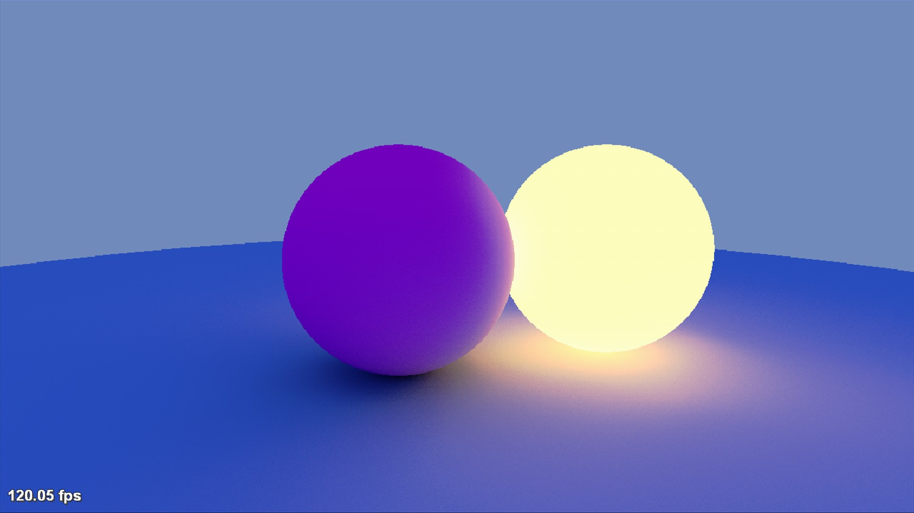

# X360RayTracing

Ray tracing experiment on the Xbox 360.



This project is an Xbox 360 port of [TheCherno's RayTracing renderer](https://github.com/TheCherno/RayTracing) built entirely on YouTube in [a fantastic series](https://www.youtube.com/playlist?list=PLlrATfBNZ98edc5GshdBtREv5asFW3yXl).
The Cherno implemented a CPU-side ray tracer but this project utilizes the GPU as much as possible to do the heavy calculations.

## Building

### Requirements

- Having the Xbox 360 Software Development Kit (XDK) installed.
- Xbox 360 Neighborhood set up with your RGH/Jtag/Devkit registered as the default console (only necessary if you wan't to deploy to your console automatically).

### Visual Studio 2010

Open `X360RayTracing.sln` in Visual Studio.

### Any other environment

Xbox 360 projects can't be built with the 64-bit version of MSBuild, you need to run the 32-bit version. You can make yourself an alias for convenience:

```PS1
# Create an alias to the 32-bit version of MSBuild named msbuild
# The default installation path of VS2026 is C:\Program Files\Microsoft Visual Studio\18\Community
Set-Alias msbuild "<path_vs2026>\MSBuild\Current\Bin\MSBuild.exe"
```

Now run `msbuild` to compile the app and deploy it to your console.
